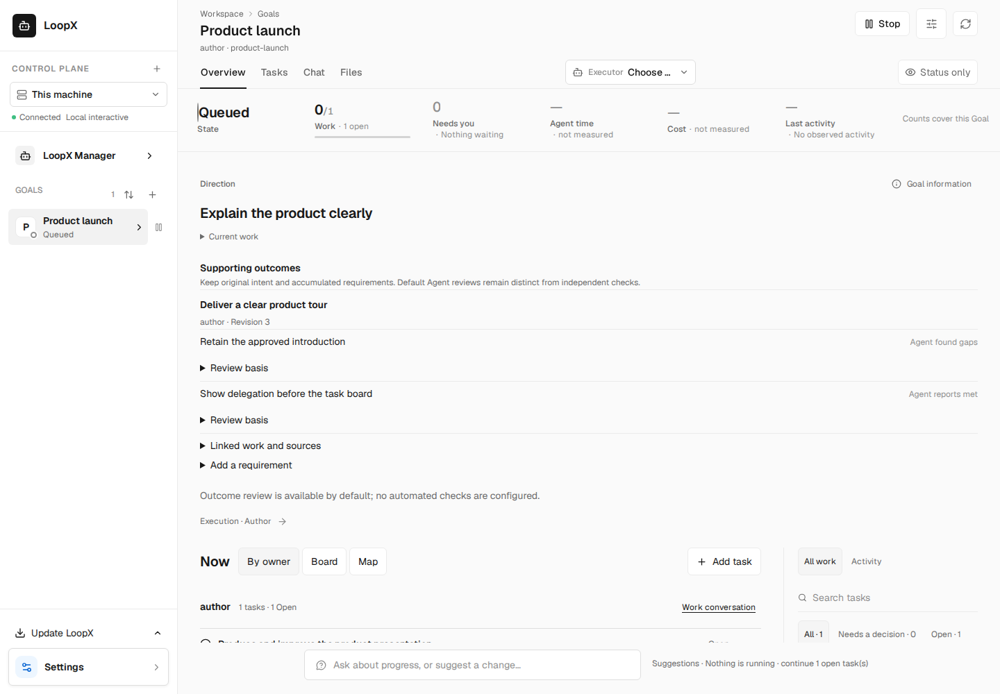
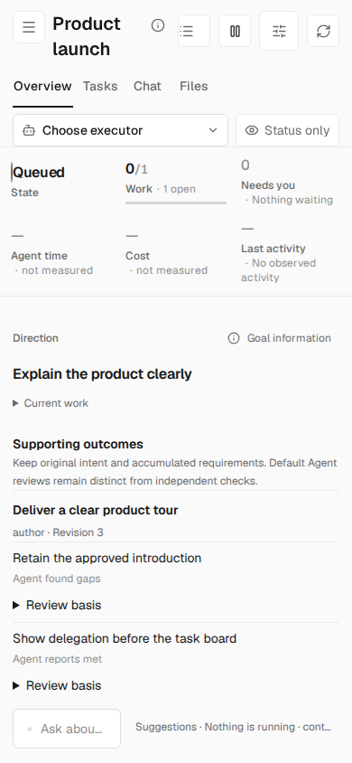
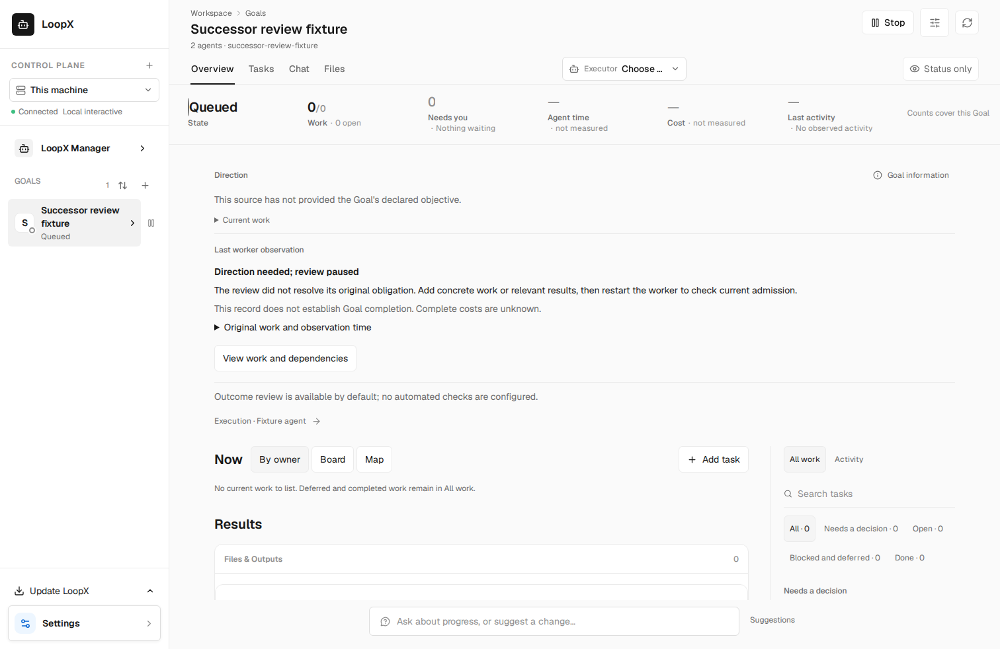
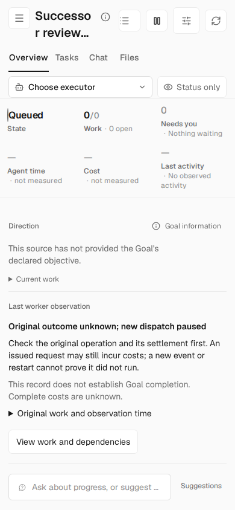

# Research split validation and UI evidence

These assets were captured from commit `d1dc8ebfe7ff0ce888c8e7a6b7a5051413f29af2`, tree `cb8b1777655d7f37e3571b5087d6cd4db286dbbd`, on the frozen main base `45d742088a3f7896a0a008761f68d2437398bcd1`. Task data is synthetic; the scenarios use real disposable local authorities and HTTP/CLI entrypoints. The images retain their actual capture revision after later source repairs.

[Validation summary](validation-summary.json) records actual executed scopes, timings, retained failures and limits. It is an execution summary, not a reconstructed raw receipt; the original temporary raw logs were reclaimed by the execution environment. This evidence does not grant CI/review approval for a later head or current main.

## Normal first viewport

Fresh browser contexts, natural scroll position 0: desktop 1440×1000 and narrow 390×844.

## Recovery states

These views scroll to the recovery form and are not relabeled as initial viewports.

- [Draft during loading](outcomes-draft-loading.png)
- [Pending operation during loading](outcomes-pending-loading.png)
- [Read failure, desktop](outcomes-read-failure-desktop.png)
- [Read failure, narrow](outcomes-read-failure-narrow.png)

## Worker readback

The original complete paused/unknown scenario passed on the same commit. Published English captures have legible glyphs.

## Qualification limits

The complete research-history functional scenario passed, but its new Chinese captures lacked CJK glyph coverage. A font-complete capture remains outstanding and those images are not included as qualified visuals. The first Outcome fixture bootstrap failed within its unchanged 90-second deadline; the later successful run used normal import caches after explicit prewarm. No cold-start, installed-app, external-model or benchmark benefit claim is made.

The landing order and current review blockers are maintained in [PR #6838](https://github.com/loopx-project/loopx/pull/6838).
